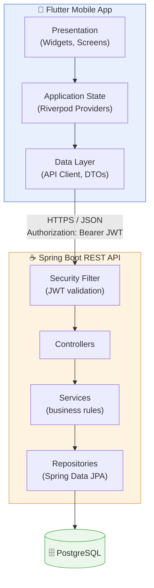
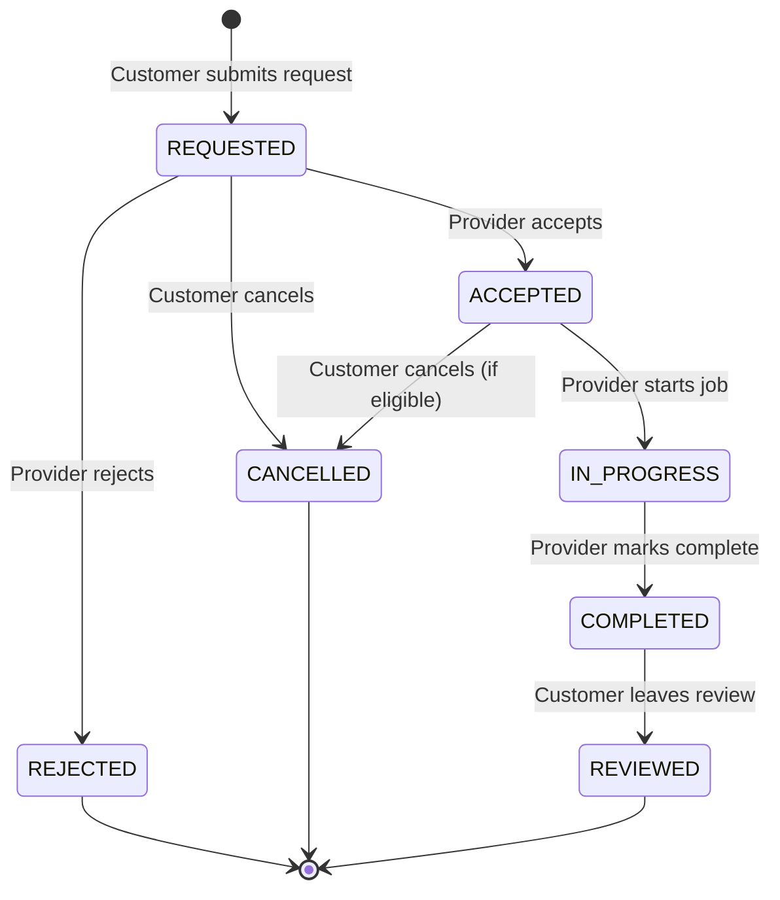
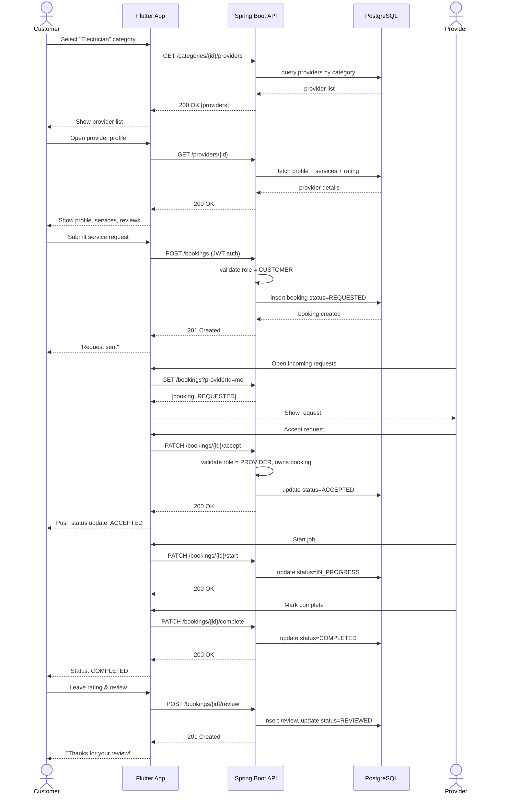
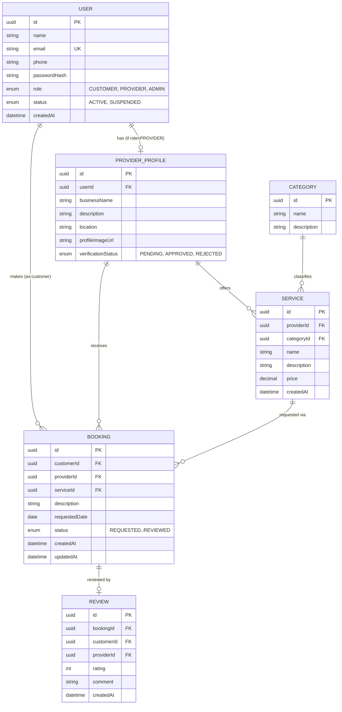

# KaziLink Rwanda

**A mobile-first service marketplace connecting customers with trusted local service providers across Rwanda.**

> Portfolio project — Flutter · Spring Boot · PostgreSQL
> Timeline: **14-day MVP sprint**

---

## Table of Contents

1. [Overview](#1-overview)
2. [The Problem](#2-the-problem)
3. [User Roles](#3-user-roles)
4. [Tech Stack](#4-tech-stack)
5. [System Architecture](#5-system-architecture)
6. [Repository Structure](#6-repository-structure)
7. [Booking Workflow](#7-booking-workflow)
8. [Sequence Diagram — Request a Service](#8-sequence-diagram--request-a-service)
9. [Database Schema](#9-database-schema)
10. [API Endpoints (MVP)](#10-api-endpoints-mvp)
11. [Flutter Screens (MVP)](#11-flutter-screens-mvp)
12. [MVP Scope vs. Future Features](#12-mvp-scope-vs-future-features)
13. [14-Day Roadmap](#13-14-day-roadmap)
14. [Highest-Risk Technical Areas](#14-highest-risk-technical-areas)
15. [Development Checklist](#15-development-checklist)
16. [Working with Claude on This Project](#16-working-with-claude-on-this-project)
17. [Learning Objectives](#17-learning-objectives)
18. [Definition of Done](#18-definition-of-done)
19. [Getting Started (Local Development)](#19-getting-started-local-development)

---

## 1. Overview

KaziLink Rwanda is a mobile marketplace that helps people in Rwanda find reliable local service providers — electricians, plumbers, mechanics, cleaners, painters, tutors, tailors, phone/computer repair technicians, and more — and request their services directly from a phone.

It is being built as a **real-world portfolio project** to demonstrate:

- Flutter mobile development with clean architecture
- A secure Spring Boot REST API
- Relational database design (PostgreSQL)
- JWT authentication & role-based authorization
- End-to-end integration between a mobile client and a backend service

This is an **MVP**. The scope is intentionally narrow so it can be built, tested, and demoed within two weeks — see [Section 12](#12-mvp-scope-vs-future-features) for what is explicitly out of scope.

## 2. The Problem

**Customers** struggle to know:
- Who offers a given service nearby
- Whether a provider is trustworthy
- What they charge and whether they're available
- How to contact/request them, and whether past customers were satisfied

**Service providers** struggle to:
- Reach new customers beyond word-of-mouth
- Get discovered online
- Manage incoming requests in an organized way

KaziLink solves this with one platform: customers discover verified providers, view profiles and reviews, request services, and track the request through to completion.

## 3. User Roles

| Role | Core Capabilities |
|---|---|
| **Customer** | Register/login, browse categories, search & filter providers, view provider profiles & services, submit a service request, track request status, cancel eligible requests, review completed services |
| **Service Provider** | Register/login, build a professional profile, list services with pricing, receive & respond to requests (accept/reject), update job status, view completed jobs and reviews |
| **Administrator** | View users & providers, approve/reject provider accounts, manage service categories, review reports, suspend accounts |

## 4. Tech Stack

| Layer | Technology |
|---|---|
| Mobile | Flutter, Dart, Material 3, Riverpod (state), GoRouter (navigation) |
| Backend | Java, Spring Boot, Spring Security, JWT, Bean Validation |
| Database | PostgreSQL |
| Tooling | Git, GitHub, Docker, Docker Compose |

## 5. System Architecture

The system is a classic 3-tier mobile architecture: a Flutter client talks to a stateless REST API, which is the only component allowed to touch the database.



**Design principles:**
- The **backend is the single source of truth** for business rules (e.g. booking status transitions, role permissions). The Flutter app never enforces security-sensitive logic itself.
- The Flutter app is layered into **presentation → state/application → data**, one folder per feature (see [Section 6](#6-repository-structure)).
- The backend follows **Controller → Service → Repository → Entity**, one package per domain concept.

## 6. Repository Structure

This repo hosts both applications side by side, each independently runnable:

```
KaziLink_Rwanda/
├── mobile/                        # Flutter application
│   ├── lib/
│   │   ├── core/                  # cross-cutting concerns
│   │   │   ├── constants/
│   │   │   ├── errors/
│   │   │   ├── network/           # Dio/http client, interceptors
│   │   │   ├── theme/             # Material 3 light/dark theme
│   │   │   └── utils/
│   │   ├── features/               # one folder per vertical slice
│   │   │   ├── auth/{data,domain,presentation}
│   │   │   ├── home/{data,domain,presentation}
│   │   │   ├── providers/{data,domain,presentation}
│   │   │   ├── services/{data,domain,presentation}
│   │   │   ├── bookings/{data,domain,presentation}
│   │   │   ├── reviews/{data,domain,presentation}
│   │   │   ├── profile/{data,domain,presentation}
│   │   │   └── admin/{data,domain,presentation}
│   │   └── main.dart
│   ├── assets/
│   └── test/
│
├── backend/                       # Spring Boot application
│   └── src/main/java/rw/kazilink/
│       ├── auth/
│       ├── user/
│       ├── provider/
│       ├── service/
│       ├── booking/
│       ├── review/
│       ├── category/
│       ├── admin/
│       ├── security/               # JWT filter, config, role guards
│       └── common/                 # shared DTOs, exceptions
│
└── docs/                          # architecture notes, ER diagrams, Postman collection
```

> Folders are currently scaffolded as empty placeholders (`.gitkeep`). `flutter create` and the Spring Boot project generation happen when we start **Feature 1** in the roadmap below — intentionally not yet, per the two-week plan.

## 7. Booking Workflow

The service request lifecycle is the core business workflow of the app, and the backend is solely responsible for enforcing valid transitions.



| Actor | Allowed transitions |
|---|---|
| Customer | Create `REQUESTED`, cancel an eligible request, review a `COMPLETED` request |
| Provider | Accept/reject a `REQUESTED` request, start an `ACCEPTED` request, complete an `IN_PROGRESS` request |

## 8. Sequence Diagram — Request a Service

Walkthrough of the flagship demo scenario: a customer finds an electrician and books a job through to completion.



## 9. Database Schema

Minimum viable schema for the MVP.



**Key constraints to design carefully:**
- `PROVIDER_PROFILE.userId` is unique — one profile per user.
- `REVIEW.bookingId` is unique — one review per booking, and only allowed when `status = COMPLETED`.
- `BOOKING.status` transitions are enforced in the **service layer**, not the database, but should still be a constrained enum.

## 10. API Endpoints (MVP)

| Method | Endpoint | Role | Description |
|---|---|---|---|
| POST | `/api/auth/register` | Public | Register as customer or provider |
| POST | `/api/auth/login` | Public | Authenticate, receive JWT |
| GET | `/api/categories` | Public | List service categories |
| GET | `/api/providers` | Public | List/search/filter providers |
| GET | `/api/providers/{id}` | Public | Provider profile + services + rating |
| POST | `/api/providers/me` | Provider | Create/update own profile |
| GET | `/api/providers/me/services` | Provider | List own services |
| POST | `/api/providers/me/services` | Provider | Add a service |
| PUT | `/api/providers/me/services/{id}` | Provider | Edit a service |
| POST | `/api/bookings` | Customer | Create a service request |
| GET | `/api/bookings?role=customer\|provider` | Customer/Provider | List own bookings |
| GET | `/api/bookings/{id}` | Owner | Booking details |
| PATCH | `/api/bookings/{id}/accept` | Provider | Accept a request |
| PATCH | `/api/bookings/{id}/reject` | Provider | Reject a request |
| PATCH | `/api/bookings/{id}/start` | Provider | Mark in progress |
| PATCH | `/api/bookings/{id}/complete` | Provider | Mark completed |
| PATCH | `/api/bookings/{id}/cancel` | Customer | Cancel eligible request |
| POST | `/api/bookings/{id}/review` | Customer | Review a completed booking |
| GET | `/api/admin/providers?status=pending` | Admin | List providers pending approval |
| PATCH | `/api/admin/providers/{id}/approve` | Admin | Approve/reject a provider |
| GET | `/api/admin/categories` / `POST` / `PUT` | Admin | Manage categories |

## 11. Flutter Screens (MVP)

| Group | Screens |
|---|---|
| Auth | Splash, Login, Register |
| Customer | Home, Categories, Provider List, Search/Filters, Provider Details, Service Details, Request Service, My Bookings, Booking Details, Profile, Settings |
| Provider | Dashboard, Profile Management, My Services, Add/Edit Service, Incoming Requests, Booking Details, Completed Jobs, Settings |
| Admin | Dashboard, Providers, Provider Approval, Categories |

Every API-dependent screen implements **loading / success / empty / error** states.

## 12. MVP Scope vs. Future Features

### ✅ In scope for the 2-week MVP
1. Authentication (customer & provider, JWT)
2. Provider profiles & verification
3. Service categories & listings
4. Customer search/discovery + basic filtering
5. Service requests (bookings)
6. Booking status workflow
7. Reviews
8. Admin provider approval
9. Light/dark/system theming
10. Realistic seed/demo data

### 🚫 Explicitly out of scope (do not build yet)
- Real-time chat
- Online/mobile money payments
- Maps / GPS integration
- AI-based recommendations
- Push notifications
- Provider availability calendars
- Favourites, disputes, advanced analytics

> These are documented in [Section 13](#13-14-day-roadmap) only as *future* considerations if time remains — never at the cost of core MVP scope.

## 13. 14-Day Roadmap

Built as **vertical slices**: for each feature, backend → API test → Flutter → integration → tests, before moving on.

| Day | Focus |
|---|---|
| 1 | Project setup: `flutter create`, Spring Boot init, PostgreSQL + Docker Compose, base folder structure |
| 2 | Auth backend: register/login, password hashing, JWT issuing, role model |
| 3 | Auth Flutter: login/register screens, token storage, Riverpod auth state, route guarding |
| 4 | Provider profile backend + Flutter: create/edit profile, provider dashboard |
| 5 | Categories & services backend + Flutter: CRUD services, category browsing |
| 6 | Customer discovery: provider list, search, filters (backend + Flutter) |
| 7 | Provider details screen + service details + seed data population |
| 8 | Bookings backend: create request, status transition rules, authorization checks |
| 9 | Bookings Flutter: request service flow, my bookings list, booking details |
| 10 | Provider-side booking management: incoming requests, accept/reject/start/complete |
| 11 | Reviews backend + Flutter: review form, rating display, provider rating aggregation |
| 12 | Admin: provider approval, category management (simple dashboard) |
| 13 | Theming polish, error/loading/empty states audit, key unit tests |
| 14 | Integration pass, seed data review, deployment, final README/demo prep |

## 14. Highest-Risk Technical Areas

| Risk | Why it's risky | Mitigation |
|---|---|---|
| JWT auth + role-based authorization | Easy to get subtly wrong (leaking access across roles/owners) | Write authorization tests early; centralize role checks in the service layer |
| Booking status state machine | Multiple actors, many invalid transitions possible | Enforce transitions in one place (`BookingService`), cover with unit tests |
| Flutter ↔ API contract drift | Manual DTOs on both sides can desync | Freeze request/response shapes per feature before writing Flutter code |
| Time-boxing to 14 days | Feature creep is the #1 threat to finishing | Follow the MVP scope in [Section 12](#12-mvp-scope-vs-future-features) strictly |
| Seed data realism | Empty-looking demo hurts portfolio value | Write a seed script/migration early (Day 7), not at the end |

## 15. Development Checklist

- [x] Repo initialized, `mobile/` and `backend/` scaffolded
- [x] Docker Compose running PostgreSQL locally
- [x] Spring Boot project builds and connects to DB
- [x] Flutter project builds on a device/emulator
- [x] JWT auth working end-to-end (register → login → authenticated request)
- [x] Role-based access enforced and tested
- [x] Provider profile CRUD working
- [ ] Category + service CRUD working
- [ ] Search/filter working
- [ ] Booking workflow enforced server-side and reflected in Flutter
- [ ] Reviews working and tied to completed bookings
- [ ] Admin approval flow working
- [ ] Light/dark/system theme implemented and persisted
- [ ] Loading/success/empty/error states on every API-backed screen
- [ ] Seed data loaded (providers, categories, services, bookings, reviews)
- [x] Key backend tests passing (auth, booking rules, authorization)
- [x] Key Flutter tests passing (state logic, form validation)
- [ ] App deployed / backend hosted
- [ ] README finalized, architecture explainable in an interview

## 16. Working with Claude on This Project

Claude is used as a **coding assistant and teacher**, not a code generator. For every feature, the workflow is:

1. Explain the problem
2. Explain the proposed solution
3. Explain the architecture
4. List files to be created/modified
5. Explain the data flow
6. Implement a small step
7. Test the step
8. Explain the important code
9. Ask interview questions about what was implemented
10. Move to the next step

**Rules:**
- Read this README before making changes.
- Don't rewrite unrelated files or introduce new packages without a clear reason.
- Don't add unnecessary abstractions — prefer simple, maintainable code.
- When multiple approaches exist, explain the trade-offs and recommend one before implementing.
- Diagnose root causes before changing code; never hide errors with workarounds.

## 17. Learning Objectives

By the end of this project, the goal is to be able to explain, not just have working code for:

Flutter widget lifecycle · Stateless vs. Stateful widgets · Riverpod state management · GoRouter navigation · REST API design · HTTP & JSON serialization · `async`/`await` · JWT authentication · role-based authorization · local storage · form validation · error handling · Flutter & backend architecture · database relationships · testing · Docker · deployment.

If a piece of generated code can't be explained, stop and learn that concept before continuing.

## 18. Definition of Done

- [ ] Customers and providers can register/login
- [ ] Admin can manage and approve providers
- [ ] Providers can create profiles and services
- [ ] Customers can discover, search, and filter providers
- [ ] Customers can request services and track status
- [ ] Providers can accept/reject/update booking status
- [ ] Customers can review completed services
- [ ] Auth and authorization work correctly end-to-end
- [ ] PostgreSQL persists all application data via the Spring Boot API
- [ ] Loading/error/empty states handled throughout
- [ ] Light/dark/system themes work and persist
- [ ] Realistic demo data is seeded
- [ ] Important functionality has tests
- [ ] Application is deployed
- [ ] The architecture and key decisions can be explained in an interview

---

## 19. Getting Started (Local Development)

### Prerequisites

| Tool | Used for |
|---|---|
| Flutter SDK (3.29+) | `mobile/` |
| JDK 21 | `backend/` |
| Maven (or use the bundled `./mvnw`) | building/running the backend |
| Docker Desktop | local PostgreSQL |

### 1. Start PostgreSQL

```bash
docker compose up -d
```

> **Port note:** the container is mapped to **host port `5433`**, not the Postgres default `5432` — this avoids clashing with a native PostgreSQL install some machines already have running as a service. If your machine has no such conflict, feel free to change it back to `5432:5432` in `docker-compose.yml` (and `DB_PORT` below).

### 2. Configure the backend

```bash
cp backend/.env.example backend/.env
# then edit backend/.env if you changed any defaults
```

`backend/.env` is git-ignored — it's where `DB_USERNAME`, `DB_PASSWORD`, `DB_PORT`, and `JWT_SECRET` live locally. `application.yml` reads them via `${VAR_NAME:default}` placeholders, so sensible defaults exist even if you skip this step.

### 3. Run the backend

```bash
cd backend
./mvnw spring-boot:run
```

The API starts on **`http://localhost:8081`** (not `8080` — same reasoning as the DB port: something else may already be using it on your machine; change `SERVER_PORT` if yours is free). On first boot you should see `Started BackendApplication` in the logs. Since no endpoints exist yet, hitting `http://localhost:8081/` returns `401 Unauthorized` — that's Spring Security correctly locking down everything by default, not a bug.

### 4. Run the Flutter app

```bash
cd mobile
flutter pub get
flutter run
```

Pick any available device when prompted (Chrome, Windows desktop, or an Android emulator once one is configured). You should see a "Project setup complete" placeholder screen — this gets replaced by the real splash/login screen in the Authentication feature.

### Everyday commands

| Command | What it does |
|---|---|
| `docker compose down` | stop the database (keeps its data) |
| `docker compose down -v` | stop the database **and delete all data** |
| `cd backend && ./mvnw test` | run backend tests |
| `cd mobile && flutter test` | run Flutter tests |
| `cd mobile && flutter analyze` | lint the Flutter codebase |

---

*Repository layout: `mobile/` (Flutter) and `backend/` (Spring Boot) are scaffolded, dependency-installed, and verified to boot end-to-end. Ready for Feature 2 (Authentication) in the roadmap above.*
