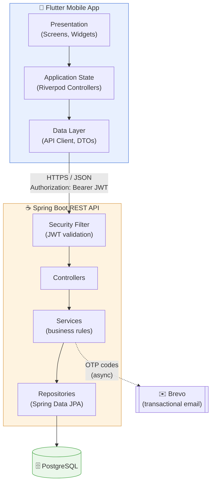
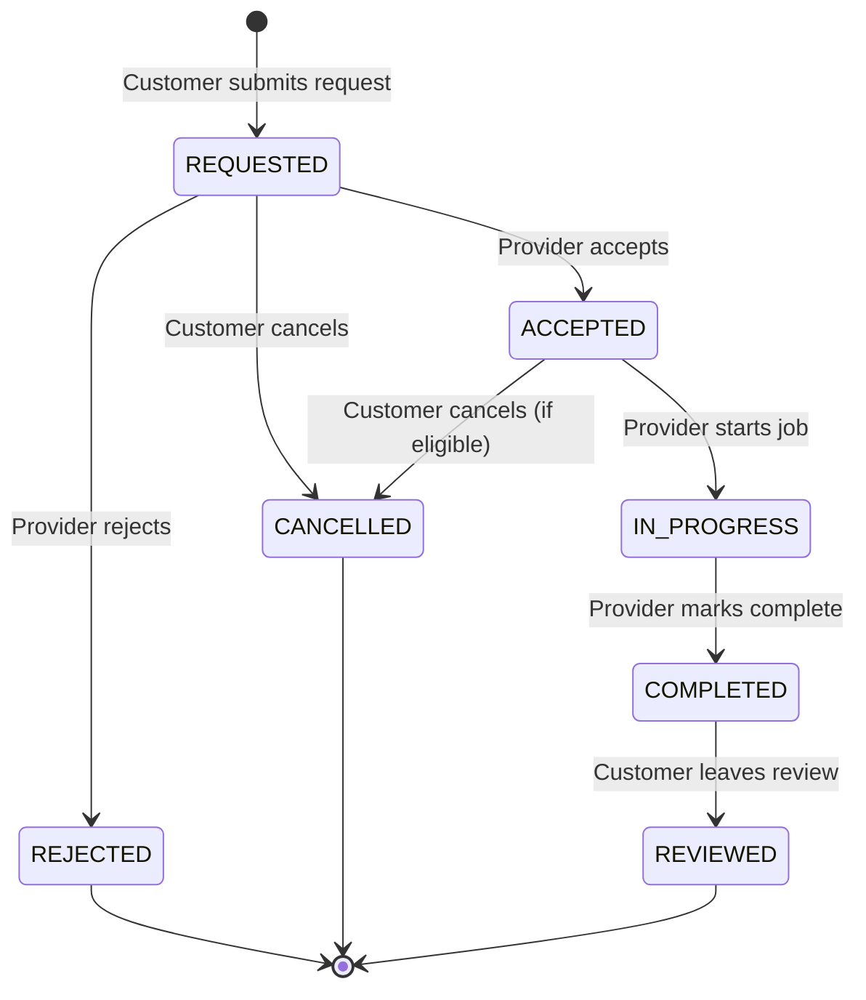
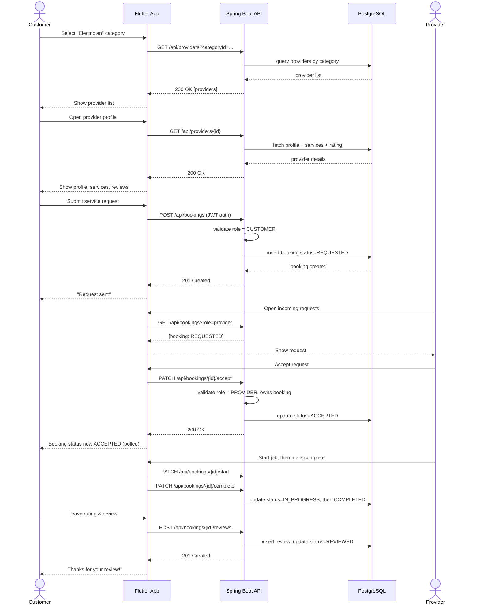
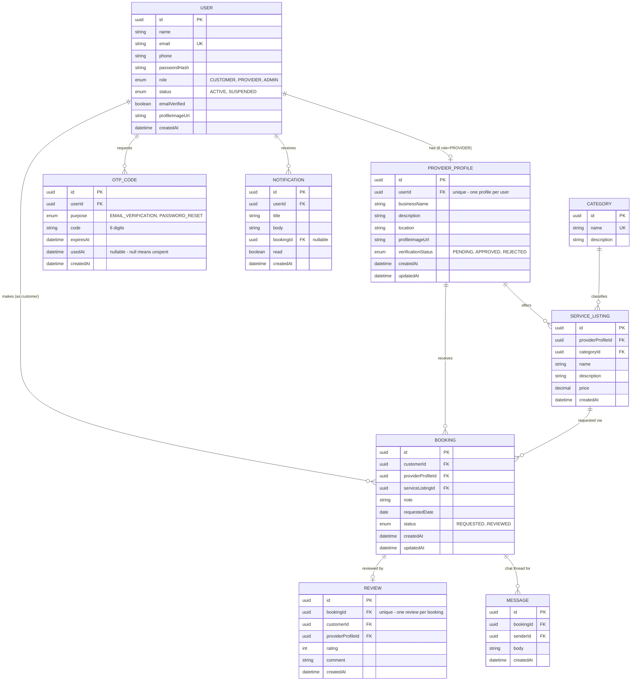

<div align="center">
  

# Fasha

**A mobile-first service marketplace connecting customers with trusted local service providers across Rwanda.**


</div>

---

> The repository, Java package (`rw.kazilink`), and some internal identifiers predate a rebrand from the project's original name, KaziLink, to **Fasha**. This README reflects the current name and product throughout.

---

## Table of Contents

1. [Overview](#1-overview)
2. [The Problem](#2-the-problem)
3. [User Roles](#3-user-roles)
4. [Tech Stack](#4-tech-stack)
5. [System Architecture](#5-system-architecture)
6. [Repository Structure](#6-repository-structure)
7. [Booking Workflow](#7-booking-workflow)
8. [Sequence Diagram — Request a Service](#8-sequence-diagram--request-a-service)
9. [Database Schema](#9-database-schema)
10. [API Reference](#10-api-reference)
11. [Screens](#11-screens)
12. [Engineering Decisions](#12-engineering-decisions)
13. [Roadmap](#13-roadmap)
14. [Testing](#14-testing)
15. [Getting Started (Local Development)](#15-getting-started-local-development)

---

## 1. Overview

Fasha is a mobile marketplace that helps people in Rwanda find reliable local service providers — electricians, plumbers, mechanics, cleaners, painters, tutors, tailors, phone/computer repair technicians, and more — and request their services directly from a phone.

The platform connects two sides of the market through a single mobile app: customers who need a service done, and providers who offer one. A Flutter client talks to a Spring Boot REST API backed by PostgreSQL, with JWT authentication, email-based verification, and role-based access control for customers, providers, and administrators.

## 2. The Problem

**Customers** struggle to know:

- Who offers a given service nearby
- Whether a provider is trustworthy
- What they charge and whether they're available
- How to contact/request them, and whether past customers were satisfied

**Service providers** struggle to:

- Reach new customers beyond word-of-mouth
- Get discovered online
- Manage incoming requests in an organized way

Fasha solves this with one platform: customers discover verified providers, view profiles and reviews, request services, message the provider directly, and track the request through to completion.

## 3. User Roles

| Role                 | Core Capabilities                                                                                                                                                                                    |
| -------------------- | ---------------------------------------------------------------------------------------------------------------------------------------------------------------------------------------------------- |
| **Customer**         | Register/verify email, browse categories, view provider profiles & services, request a service, message the provider, track request status, cancel eligible requests, review completed services      |
| **Service Provider** | Register/verify email, build a business profile, list services with pricing, receive & respond to requests (accept/reject), update job status, message the customer, view completed jobs and reviews |
| **Administrator**    | Approve or reject pending provider accounts, manage the service category list                                                                                                                        |

## 4. Tech Stack

| Layer            | Technology                                                                                                                                                                                                                                                       |
| ---------------- | ---------------------------------------------------------------------------------------------------------------------------------------------------------------------------------------------------------------------------------------------------------------- |
| Mobile           | Flutter (Dart), Material 3, [Riverpod](https://pub.dev/packages/flutter_riverpod) 2.6 (state), [GoRouter](https://pub.dev/packages/go_router) 14.6 (declarative navigation with auth/onboarding redirect guards), [Dio](https://pub.dev/packages/dio) 5.7 (HTTP) |
| Mobile — storage | `flutter_secure_storage` (JWT, encrypted), `shared_preferences` (theme mode, onboarding flag)                                                                                                                                                                    |
| Mobile — other   | `google_fonts` (Plus Jakarta Sans), `image_picker` (avatar upload), `url_launcher` (tap-to-call)                                                                                                                                                                 |
| Backend          | Java 21, Spring Boot 4.1 (Spring 7 / Hibernate 7 / Jackson 3), Spring Security, JWT (`jjwt`), Bean Validation                                                                                                                                                    |
| Database         | PostgreSQL, schema versioned with Flyway (14 migrations, `ddl-auto: validate` — the schema is never auto-generated)                                                                                                                                              |
| Email            | [Brevo](https://www.brevo.com/) transactional email API, sent `@Async` so OTP delivery never blocks the request thread                                                                                                                                           |
| Tooling          | Git, GitHub, Docker Compose (local Postgres), Maven, JUnit 5, Mockito, Flutter's built-in test framework                                                                                                                                                         |

## 5. System Architecture

A classic 3-tier mobile architecture: a Flutter client talks to a stateless REST API, which is the only component allowed to touch the database.



**Design principles:**

- The **backend is the single source of truth** for business rules (booking status transitions, role permissions, ownership checks). The Flutter app never enforces security-sensitive logic itself.
- The Flutter app is layered per feature into **presentation → state (Riverpod) → data**, one folder per vertical slice (auth, bookings, chat, …), not one giant `screens/` folder.
- The backend follows **package-by-feature**: each domain package (`auth/`, `booking/`, `chat/`, …) holds its own controller, service, repository, and DTOs together — an explicit choice so debugging a feature never requires jumping across a `controllers/`/`services/`/`repositories/` split.

## 6. Repository Structure

```
KaziLink_Rwanda/                     # repo name predates the Fasha rebrand
├── mobile/                          # Flutter application
│   └── lib/
│       ├── core/                    # router, theme, network client, shared widgets, utils
│       └── features/                # one folder per vertical slice, each {data, domain, presentation}
│           ├── auth/                # login, register, OTP verify/reset, session state
│           ├── onboarding/          # first-run carousel (shown once per device)
│           ├── splash/
│           ├── home/                # role-adaptive dashboard (customer / provider / admin)
│           ├── providers/           # browse, provider detail, provider's own profile
│           ├── services/            # categories, service listings, provider's service CRUD
│           ├── bookings/            # request flow, my bookings, incoming requests
│           ├── reviews/
│           ├── chat/                # per-booking messaging
│           ├── notifications/
│           ├── profile/             # profile, settings/appearance, change password
│           └── admin/               # provider approval, category management
│
├── backend/                         # Spring Boot application
│   └── src/main/java/rw/kazilink/
│       ├── auth/                    # register/login/logout, JWT issuing
│       ├── otp/                     # OTP generation/validation (verification + password reset)
│       ├── email/                   # Brevo integration
│       ├── user/                    # profile, password, avatar
│       ├── provider/                # provider profile CRUD, public browse/detail
│       ├── service/                 # service listings
│       ├── category/                # service categories
│       ├── booking/                 # the booking state machine
│       ├── review/
│       ├── chat/                    # per-booking messages
│       ├── notification/
│       ├── admin/                   # provider approval, category management
│       ├── security/                # JWT filter, SecurityConfig, role guards
│       └── common/                  # shared exception handling, base DTOs
│
└── docker-compose.yml                # local PostgreSQL
```

## 7. Booking Workflow

The service request lifecycle is the core business workflow, enforced entirely server-side in `BookingService`.



| Actor    | Allowed transitions                                                                                 |
| -------- | --------------------------------------------------------------------------------------------------- |
| Customer | Create `REQUESTED`, cancel while `REQUESTED`/`ACCEPTED`, review a `COMPLETED` booking               |
| Provider | Accept/reject a `REQUESTED` booking, start an `ACCEPTED` booking, complete an `IN_PROGRESS` booking |

## 8. Sequence Diagram — Request a Service

The flagship demo scenario: a customer finds an electrician and books a job through to completion.



## 9. Database Schema

The actual shipped schema (14 Flyway migrations), not the original planning sketch.



**Key constraints:**

- `PROVIDER_PROFILE.userId` is unique — one profile per user.
- `REVIEW.bookingId` is unique, and the service layer only allows creating one when the booking's `status = COMPLETED`.
- `BOOKING.status` transitions are validated in `BookingService`, not the database — the enum column just constrains the value, not the transition.
- An `OTP_CODE` is single-use (`usedAt`) and time-boxed (`expiresAt`); the same table backs both email verification and password reset, distinguished by `purpose`.

## 10. API Reference

All endpoints are prefixed `/api`. JWT is sent as `Authorization: Bearer <token>`.

| Method                      | Endpoint                                                        | Access            | Description                                                                                                               |
| --------------------------- | --------------------------------------------------------------- | ----------------- | ------------------------------------------------------------------------------------------------------------------------- |
| POST                        | `/auth/register`                                                | Public            | Register as customer or provider; returns a JWT immediately (account is unverified until OTP is spent)                    |
| POST                        | `/auth/login`                                                   | Public            | Authenticate, receive JWT                                                                                                 |
| POST                        | `/auth/logout`                                                  | Authenticated     | Revoke the current token                                                                                                  |
| POST                        | `/auth/verify-email`                                            | Authenticated     | Spend an `EMAIL_VERIFICATION` OTP                                                                                         |
| POST                        | `/auth/resend-verification`                                     | Authenticated     | Issue a fresh verification OTP                                                                                            |
| POST                        | `/auth/forgot-password`                                         | Public            | Email a `PASSWORD_RESET` OTP (always returns the same response, whether or not the email exists — no account enumeration) |
| POST                        | `/auth/reset-password`                                          | Public            | Spend a reset OTP + email to set a new password                                                                           |
| GET                         | `/categories`                                                   | Public            | List service categories                                                                                                   |
| GET                         | `/providers`                                                    | Public            | Browse providers, optionally filtered by `categoryId`                                                                     |
| GET                         | `/providers/{id}`                                               | Public            | Provider profile + services + aggregate rating                                                                            |
| GET / PUT                   | `/providers/me`                                                 | Provider          | Get/create/update own provider profile                                                                                    |
| GET / POST                  | `/providers/me/services`                                        | Provider          | List / add own service listings                                                                                           |
| PUT                         | `/providers/me/services/{id}`                                   | Provider          | Edit a service listing                                                                                                    |
| POST                        | `/bookings`                                                     | Customer          | Create a service request                                                                                                  |
| GET                         | `/bookings`                                                     | Customer/Provider | List own bookings                                                                                                         |
| GET                         | `/bookings/{id}`                                                | Owner             | Booking detail                                                                                                            |
| PATCH                       | `/bookings/{id}/accept` \| `/reject` \| `/start` \| `/complete` | Provider          | Drive the booking state machine                                                                                           |
| PATCH                       | `/bookings/{id}/cancel`                                         | Customer          | Cancel while eligible                                                                                                     |
| POST                        | `/bookings/{id}/reviews`                                        | Customer          | Review a completed booking                                                                                                |
| GET                         | `/providers/{id}/reviews`                                       | Public            | A provider's reviews                                                                                                      |
| GET / POST                  | `/bookings/{id}/messages`                                       | Owner             | Per-booking chat thread                                                                                                   |
| GET                         | `/notifications`                                                | Authenticated     | List own notifications                                                                                                    |
| GET                         | `/notifications/unread-count`                                   | Authenticated     | Badge count                                                                                                               |
| PATCH                       | `/notifications/{id}/read` \| `/read-all`                       | Authenticated     | Mark read                                                                                                                 |
| GET / PATCH                 | `/users/me`                                                     | Authenticated     | Get/update own account                                                                                                    |
| PUT                         | `/users/me/password`                                            | Authenticated     | Change password                                                                                                           |
| POST                        | `/users/me/avatar`                                              | Authenticated     | Upload avatar image                                                                                                       |
| GET                         | `/admin/providers?status=pending`                               | Admin             | List providers awaiting approval                                                                                          |
| PATCH                       | `/admin/providers/{id}/approve`                                 | Admin             | Approve/reject a provider                                                                                                 |
| GET / POST / PATCH / DELETE | `/admin/categories`                                             | Admin             | Manage the category list                                                                                                  |

## 11. Screens

| Group             | Screens                                                                                                                                                          |
| ----------------- | ---------------------------------------------------------------------------------------------------------------------------------------------------------------- |
| Onboarding & Auth | Splash · Onboarding carousel (first run only) · Login · Register · Verify Email (OTP) · Forgot Password · Reset Password (OTP)                                   |
| Customer          | Home (category grid) · Provider List (by category) · Provider Detail (services + reviews) · Request a Booking · My Bookings (status, cancel, review, chat, call) |
| Provider          | Dashboard · Profile Management · My Services · Add/Edit Service · Incoming Requests (accept/reject/start/complete)                                               |
| Admin             | Dashboard · Pending Providers (approve/reject) · Categories (add/edit)                                                                                           |
| Shared            | Profile (edit info, change password, **appearance: light/dark/system**, logout) · Chat (per booking) · Notifications · Write a Review                            |

Every API-backed screen implements loading / success / empty / error states via Riverpod's `AsyncValue`. The customer/provider/admin dashboards are one role-adaptive `HomeScreen`, not three separate screens, since they share the same shell and navigation.

## 12. Engineering Decisions

- **OTP-based auth instead of magic links.** Email verification and password reset both use a single `OtpCode` entity distinguished by a `purpose` enum, rather than two separate token tables. Reset originally shipped as a raw token displayed directly on screen (no email server yet); it was later reworked end-to-end — backend endpoint contract, Flutter controllers, and the router's redirect logic — to actually email a 6-digit code via Brevo, sent `@Async` so a slow email provider never blocks the HTTP response.
- **`@PreAuthorize` denials bypass the security-filter-level access-denied handler.** A role check failing inside a controller method throws `AuthorizationDeniedException` _during_ the controller invocation, so Spring MVC routes it to the `@RestControllerAdvice` exception handler before Spring Security's filter-level handler ever sees it — easy to miss, and it silently degrades role-protected endpoints to a 500 instead of a 403 if the advice class doesn't have an explicit handler for it.
- **JPA `@PreUpdate` timing.** `updatedAt` fields stamped by a `@PreUpdate` callback only get their new value at actual flush time. Building a response DTO from an entity right after a plain `.save()` (which doesn't force a flush) can serialize a stale timestamp even though the database itself is correct — `saveAndFlush` is required when the response is built in the same method as the update.
- **Spring Boot 4.1 ships Jackson 3**, which renamed its base package from `com.fasterxml.jackson` to `tools.jackson` — a good example of why pinning framework versions and reading changelogs matters even for "routine" upgrades.
- **The booking status machine lives in exactly one place** (`BookingService`), not scattered across controllers — every transition is one method, one authorization check, one set of valid-previous-states, so adding a new transition later can't accidentally skip a rule that already exists elsewhere.
- **No account enumeration on password reset.** `forgot-password` always returns the same response regardless of whether the email is registered — the OTP is only useful if you already control that inbox.

## 13. Roadmap

Tracked in detail in [`PROJECT_STATUS.md`](PROJECT_STATUS.md), kept in sync with the codebase as work lands.

**Shipped:** authentication (JWT + OTP verification/reset), provider profiles, categories & service listings, the full booking state machine, reviews, admin provider approval, chat, notifications, onboarding, and light/dark/system theming.

**In progress / planned:**

- Text and location search & filtering on the provider browse screen (category-based browsing is live; free-text search is not yet)
- Demo/seed data covering providers, services, bookings, and reviews (categories are seeded)
- Production deployment (containerized backend, CI/CD, hosting)

## 14. Testing

|                             | Count                                                                                                                   | Run with                       |
| --------------------------- | ----------------------------------------------------------------------------------------------------------------------- | ------------------------------ |
| Backend (JUnit 5 + Mockito) | 90 passing unit/service tests, covering auth, OTP, booking transitions, authorization, and the global exception handler | `cd backend && ./mvnw test`    |
| Flutter                     | Form/validation unit tests (auth, provider profile, service listing) + a widget smoke test                              | `cd mobile && flutter test`    |
| Static analysis             | `flutter analyze` — zero issues                                                                                         | `cd mobile && flutter analyze` |

`BackendApplicationTests.contextLoads` requires a live PostgreSQL connection (it's an integration test, not a unit test) — start `docker compose up -d` first if it fails locally.

## 15. Getting Started (Local Development)

### Prerequisites

| Tool                            | Used for                     |
| ------------------------------- | ---------------------------- |
| Flutter SDK (3.29+)             | `mobile/`                    |
| JDK 21                          | `backend/`                   |
| Maven (or the bundled `./mvnw`) | building/running the backend |
| Docker Desktop                  | local PostgreSQL             |

### 1. Start PostgreSQL

```bash
docker compose up -d
```

> **Port note:** mapped to host port **`5433`**, not Postgres's default `5432`, to avoid clashing with a native PostgreSQL install some machines already run as a service. Change it back to `5432:5432` in `docker-compose.yml` (and `DB_PORT` below) if that doesn't apply to your machine.

### 2. Configure the backend

```bash
cp backend/.env.example backend/.env
# edit backend/.env for DB_USERNAME / DB_PASSWORD / DB_PORT / JWT_SECRET / Brevo API key
```

`backend/.env` is git-ignored; `application.yml` reads it via `${VAR_NAME:default}` placeholders, so sensible defaults exist even if you skip this step (email sending will simply fail without a real Brevo key).

### 3. Run the backend

```bash
cd backend
./mvnw spring-boot:run
```

Starts on **`http://localhost:8081`** (not `8080` — likely already in use on a dev machine; change `SERVER_PORT` if yours is free). Flyway runs its 14 migrations automatically on first boot.

### 4. Run the Flutter app

```bash
cd mobile
flutter pub get
flutter run
```

Pick any available device (Chrome, Windows desktop, or an Android emulator).

### Everyday commands

| Command                        | What it does                              |
| ------------------------------ | ----------------------------------------- |
| `docker compose down`          | stop the database (keeps its data)        |
| `docker compose down -v`       | stop the database **and delete all data** |
| `cd backend && ./mvnw test`    | run backend tests                         |
| `cd mobile && flutter test`    | run Flutter tests                         |
| `cd mobile && flutter analyze` | lint the Flutter codebase                 |
