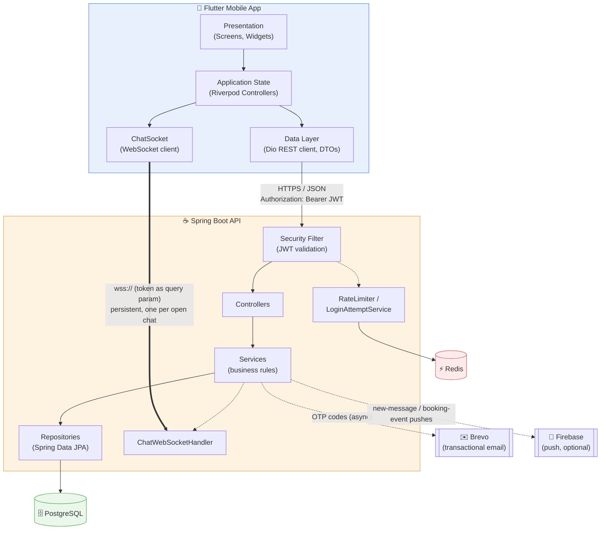
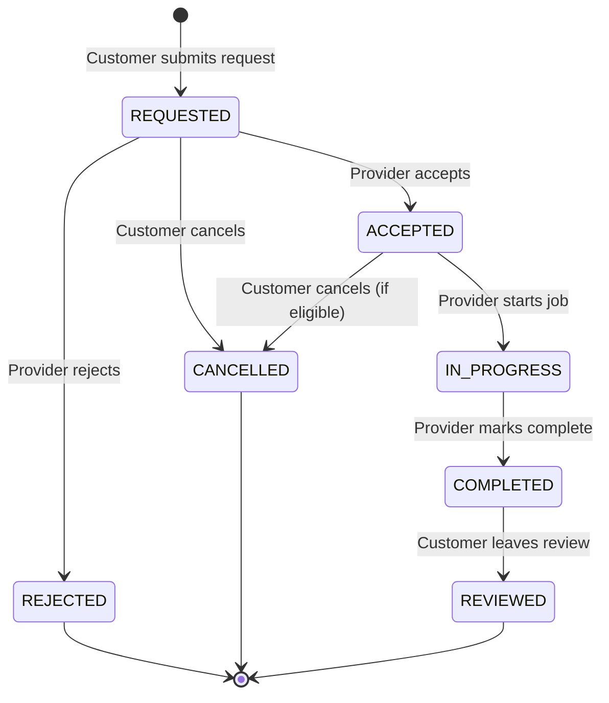
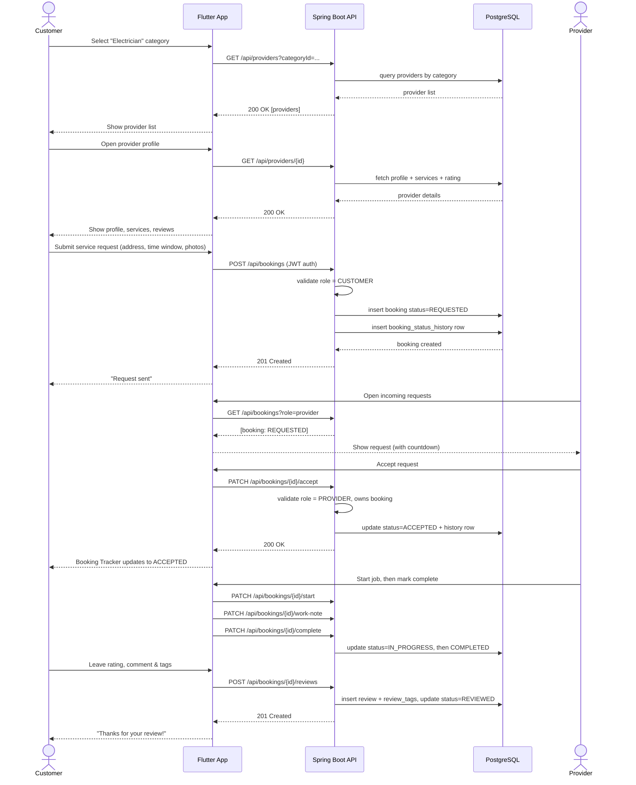
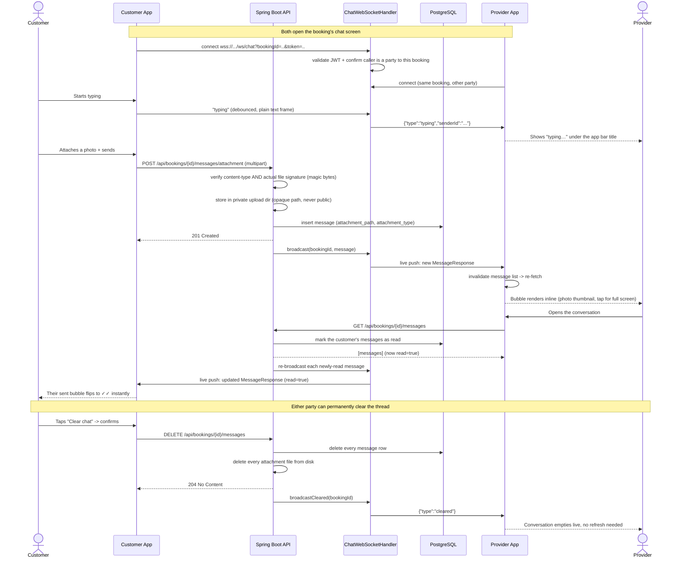
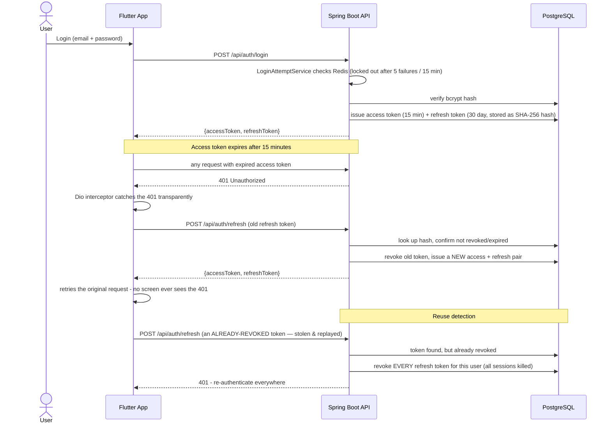
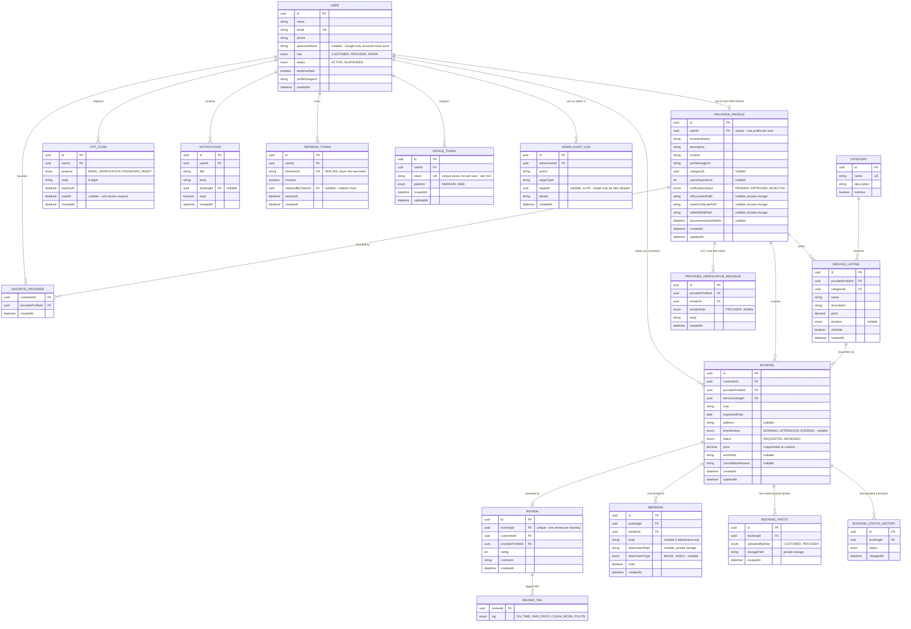

<div align="center">
  

# Fasha

**A mobile-first service marketplace connecting customers with trusted local service providers across Rwanda.**


</div>

---

> The repository, Java package (`rw.kazilink`), and some internal identifiers predate a rebrand from the project's original name, KaziLink, to **Fasha**. This README reflects the current name and product throughout.

---

## Table of Contents

1. [Overview](#1-overview)
2. [The Problem](#2-the-problem)
3. [User Roles & Capabilities](#3-user-roles--capabilities)
4. [Tech Stack](#4-tech-stack)
5. [System Architecture](#5-system-architecture)
6. [Repository Structure](#6-repository-structure)
7. [Booking Workflow](#7-booking-workflow)
8. [Sequence Diagram — Request a Service](#8-sequence-diagram--request-a-service)
9. [Sequence Diagram — Real-Time Chat](#9-sequence-diagram--real-time-chat)
10. [Security Architecture](#10-security-architecture)
11. [Database Schema](#11-database-schema)
12. [API Reference](#12-api-reference)
13. [Screens & Navigation](#13-screens--navigation)
14. [Engineering Decisions](#14-engineering-decisions)
15. [Roadmap](#15-roadmap)
16. [Testing & CI](#16-testing--ci)
17. [Getting Started (Local Development)](#17-getting-started-local-development)

---

## 1. Overview

Fasha is a mobile marketplace that helps people in Rwanda find reliable local service providers — electricians, plumbers, mechanics, cleaners, painters, tutors, tailors, phone/computer repair technicians, and more — and request their services directly from a phone.

The platform connects two sides of the market through a single mobile app: customers who need a service done, and providers who offer one, with an admin layer to keep the marketplace trustworthy. A Flutter client talks to a Spring Boot REST + WebSocket API backed by PostgreSQL and Redis, with JWT authentication (rotating refresh tokens), OTP-based email verification, identity (KYC) verification for providers, and role-based access control enforced end-to-end on the server.

At a glance: **3 user roles**, **70+ REST endpoints**, **35 Flyway migrations**, **155 backend tests**, a **real-time WebSocket chat** with typing indicators, photo/video attachments and read receipts, and a **containerized, CI-tested** backend.

## 2. The Problem

**Customers** struggle to know:

- Who offers a given service nearby
- Whether a provider is trustworthy
- What they charge and whether they're available
- How to contact/request them, and whether past customers were satisfied

**Service providers** struggle to:

- Reach new customers beyond word-of-mouth
- Get discovered online
- Prove they're legitimate (no verification/trust signal)
- Manage incoming requests in an organized way

Fasha solves this with one platform: customers discover **verified** providers, view profiles and tagged reviews, request services, message the provider directly (text, photos, or a short video of the problem), and track the request through a real timeline to completion.

## 3. User Roles & Capabilities

| Role | Core Capabilities |
| --- | --- |
| **Customer** | Register/verify email (or Google Sign-In), browse & search providers with district/price/rating filters, favorite providers, view profiles + tagged reviews, request a service (address, time window, photos of the issue), **real-time chat** with the provider (typing indicator, photo/video attachments, read receipts, clear chat), track a request on a live per-stage timeline, cancel with an optional reason, leave a rating + comment + "what stood out" tags |
| **Service Provider** | Register/verify email, build a business profile (category, years of experience, photo), submit **KYC documents** (ID, selfie, optional trade certificate) for admin review, list/edit services with pricing/duration and a visibility toggle, live dashboard (new requests / in progress / completed / rating), accept/reject incoming requests against a countdown, start a job, attach a work note + photos, mark complete, view completed jobs & earnings (this month / all time), chat with the customer, message admin about their verification status |
| **Administrator** | Approve/reject pending providers (view their submitted KYC documents first), suspend/resume/delete any customer or provider account, manage the category list (add/edit/hide, with per-category usage counts), view an analytics dashboard (booking trend, providers by category, user growth), review a full **audit log** of every admin action, reply to providers' verification questions |

## 4. Tech Stack

| Layer | Technology |
| --- | --- |
| Mobile | Flutter (Dart), Material 3, [Riverpod](https://pub.dev/packages/flutter_riverpod) 2.6 (state), [GoRouter](https://pub.dev/packages/go_router) 14.6 (declarative navigation, one role-aware `StatefulShellRoute`), [Dio](https://pub.dev/packages/dio) 5.7 (HTTP, auto-refreshes on 401) |
| Mobile — real-time & media | [`web_socket_channel`](https://pub.dev/packages/web_socket_channel) (live chat), `image_picker` + `video_player` (photo/video capture, playback, and preview — including an Android-process-death recovery path, see §14), `fl_chart` (admin analytics charts) |
| Mobile — storage | `flutter_secure_storage` (JWT, encrypted), `shared_preferences` (theme mode, onboarding flag, pending-attachment recovery marker) |
| Mobile — optional integrations | `google_sign_in` ("Continue with Google"), `firebase_core`/`firebase_messaging` (push notifications) — both inert until real credentials are configured, never block a build |
| Mobile — other | `google_fonts` (Plus Jakarta Sans / Inter), `url_launcher` (tap-to-call) |
| Backend | Java 21, Spring Boot 4.1 (Spring 7 / Hibernate 7 / Jackson 3), Spring Security, Spring WebSocket, JWT (`jjwt`) with rotating refresh tokens, Bean Validation |
| Database | PostgreSQL, schema versioned with Flyway (35 migrations, `ddl-auto: validate` — the schema is never auto-generated) |
| Caching / rate limiting | Redis (`spring-boot-starter-data-redis`) — login lockout and endpoint abuse limits, fixed-window counters via `INCR`+`EXPIRE` |
| Email | [Brevo](https://www.brevo.com/) transactional email API, sent `@Async` so OTP delivery never blocks the request thread |
| Push notifications | Firebase Cloud Messaging (Admin SDK), lazily initialized — falls back to a log-only no-op when unconfigured |
| DevOps | Docker (multi-stage build, non-root runtime user), Docker Compose (`--profile full` for the whole stack), GitHub Actions CI (real Postgres + Redis service containers) |
| Tooling | Git, GitHub, Maven, JUnit 5, Mockito, Flutter's built-in test framework |

## 5. System Architecture

A Flutter client talks to a stateless REST API for everything, plus one persistent WebSocket connection for live chat delivery. The backend is the only component allowed to touch PostgreSQL; Redis backs rate limiting, and Brevo/Firebase are optional outbound integrations that degrade gracefully when unconfigured.



**Design principles:**

- The **backend is the single source of truth** for business rules (booking status transitions, role permissions, ownership checks). The Flutter app never enforces security-sensitive logic itself.
- **REST is authoritative, WebSocket is a live nudge.** Every chat message is sent and stored via a normal REST call; the WebSocket connection only pushes "something changed" to whoever's already looking, which triggers a re-fetch. A dropped socket never loses data — reopening the screen falls back to the REST list.
- The Flutter app is layered per feature into **presentation → state (Riverpod) → data**, one folder per vertical slice (auth, bookings, chat, …), not one giant `screens/` folder.
- The backend follows **package-by-feature**: each domain package (`auth/`, `booking/`, `chat/`, …) holds its own controller, service, repository, and DTOs together — an explicit choice so debugging a feature never requires jumping across a `controllers/`/`services/`/`repositories/` split.

## 6. Repository Structure

```
KaziLink_Rwanda/                     # repo name predates the Fasha rebrand
├── mobile/                          # Flutter application
│   └── lib/
│       ├── core/                    # router (role-aware shell), theme, network client, shared widgets
│       └── features/                # one folder per vertical slice, each {data, domain, presentation}
│           ├── auth/                # login, register, Google Sign-In, OTP verify/reset, session state
│           ├── onboarding/          # first-run carousel (shown once per device)
│           ├── splash/
│           ├── home/                # role-adaptive dashboard (customer / provider / admin)
│           ├── providers/           # browse+filter, provider detail, favorites, KYC/verification chat
│           ├── services/            # categories, service listings, provider's service CRUD
│           ├── bookings/            # request flow, my bookings, incoming requests, tracker, photos
│           ├── reviews/             # tagged reviews, all-reviews breakdown
│           ├── chat/                # per-booking messaging: typing, attachments, read receipts, clear
│           ├── notifications/
│           ├── profile/             # profile, appearance (light/dark/system), change password
│           └── admin/               # provider approval, account management, categories, analytics
│
├── backend/                         # Spring Boot application
│   ├── Dockerfile                   # multi-stage build → non-root JRE runtime
│   └── src/main/java/rw/kazilink/
│       ├── auth/                    # register/login/logout/refresh, JWT + Google issuing
│       ├── otp/                     # OTP generation/validation (verification + password reset)
│       ├── email/                   # Brevo integration
│       ├── push/                    # device token registration + Firebase Cloud Messaging
│       ├── user/                    # profile, password, avatar
│       ├── provider/                # profile CRUD, KYC documents, earnings, public browse/detail
│       ├── service/                 # service listings
│       ├── category/                # service categories
│       ├── booking/                 # the booking state machine, photos, status history
│       ├── review/                  # ratings, comments, structured tags
│       ├── favorite/                # a customer's saved providers
│       ├── chat/                    # per-booking messages, attachments, WebSocket handler
│       ├── notification/            # in-app notification list
│       ├── admin/                   # approval, account mgmt, categories, stats, audit log
│       ├── security/                # JWT filter, refresh-token rotation, SecurityConfig, role guards
│       └── common/                  # shared exception handling, secure file storage, rate limiting
│
└── docker-compose.yml                # Postgres + Redis by default; `--profile full` adds the backend
```

## 7. Booking Workflow

The service request lifecycle is the core business workflow, enforced entirely server-side in `BookingService`. Every transition is also appended to `booking_status_history`, so the customer-facing tracker can show a real timestamped timeline rather than just the current state.



| Actor | Allowed transitions |
| --- | --- |
| Customer | Create `REQUESTED`, cancel while `REQUESTED`/`ACCEPTED` (optional reason), review a `COMPLETED` booking |
| Provider | Accept/reject a `REQUESTED` booking, start an `ACCEPTED` booking, complete an `IN_PROGRESS` booking (with a work note + photos) |

## 8. Sequence Diagram — Request a Service

The flagship demo scenario: a customer finds an electrician and books a job through to completion.



## 9. Sequence Diagram — Real-Time Chat

Every booking has its own conversation thread. Sending is always a plain REST call (so it's never lost if the socket is down); the WebSocket connection is purely a live push channel that tells an already-open screen "something changed" — typing, a new message, a read receipt, or the whole thread being cleared.



## 10. Security Architecture



- **Refresh-token rotation with reuse detection.** Every refresh is single-use: it revokes the old token and issues a new pair. If a *revoked* token is ever presented again, that's a signal it was copied and used out of order — the response is to kill every live session for that user, not just deny the one request.
- **Rate limiting, Redis-backed.** `LoginAttemptService` (account lockout) and a general-purpose `RateLimiter` (10/hour on booking creation and review submission) both use Redis `INCR` + `EXPIRE` fixed-window counters — the key's own TTL *is* the window, so there's nothing to clean up by hand, and the counters survive a backend restart or run correctly behind more than one instance.
- **File-upload content sniffing.** KYC documents, booking photos, avatars, and chat attachments all check the file's actual leading bytes against a real JPEG/PNG/WEBP/PDF/MP4 signature (`FileSignature`) — the client-supplied `Content-Type` header alone is trivial to fake.
- **Private vs. public storage.** Avatars are public (served from a static `/uploads/**` path); KYC documents, booking photos, and chat attachments are **never** public — they live in a separate directory with no static resource handler at all, only reachable through an authenticated, ownership-checked download endpoint.
- **Role-based access control everywhere.** `@PreAuthorize` role checks plus explicit ownership checks (e.g. "is this booking actually yours") guard every mutating endpoint — verified by a dedicated authorization test suite.
- **No account enumeration.** `forgot-password` always returns the same response whether or not the email is registered.
- **Admin audit log.** Every account-affecting admin action (approve/reject, suspend/resume/delete, category changes) is recorded with who/what/when, viewable in-app.
- **Security response headers.** CSP (`default-src 'none'`), HSTS, and `Referrer-Policy: no-referrer` are set explicitly in `SecurityConfig`.

## 11. Database Schema

The actual shipped schema (35 Flyway migrations), not the original planning sketch.



**Key constraints:**

- `PROVIDER_PROFILE.userId` is unique — one profile per user. `REVIEW.bookingId` is unique, and the service layer only allows creating one when the booking's `status = COMPLETED`.
- `BOOKING.status` transitions are validated in `BookingService`, not the database — the enum column just constrains the value, not the transition. Every transition also appends a `BOOKING_STATUS_HISTORY` row.
- A `MESSAGE` carries a text body, an attachment, or both — never neither (a `CHECK` constraint enforces it).
- `DEVICE_TOKEN.token` is unique **by itself**, not `(user, token)` — a device that logs in as a different user moves the token to the new owner instead of creating a stale duplicate.
- `REFRESH_TOKEN` never stores the raw token, only a SHA-256 hash — the same reasoning as `passwordHash` on `USER`.
- `ADMIN_AUDIT_LOG.targetId` has no foreign key on purpose: the trail must survive even if the thing it logged about is later deleted.

## 12. API Reference

All endpoints are prefixed `/api`. JWT is sent as `Authorization: Bearer <token>`.

**Auth** (`/api/auth`)

| Method | Endpoint | Access | Description |
| --- | --- | --- | --- |
| POST | `/register` | Public | Register as customer or provider; returns tokens immediately (account is unverified until OTP is spent) |
| POST | `/login` | Public | Authenticate with email/password |
| POST | `/google` | Public | Authenticate with a Google ID token |
| POST | `/refresh` | Public | Exchange a refresh token for a new access+refresh pair (rotation) |
| POST | `/logout` | Authenticated | Revoke the current session's refresh token |
| POST | `/verify-email` | Authenticated | Spend an `EMAIL_VERIFICATION` OTP |
| POST | `/resend-verification` | Authenticated | Issue a fresh verification OTP |
| POST | `/forgot-password` | Public | Email a `PASSWORD_RESET` OTP (same response either way — no account enumeration) |
| POST | `/reset-password` | Public | Spend a reset OTP + email to set a new password |

**Categories** (`/api/categories`, `/api/admin/categories`)

| Method | Endpoint | Access | Description |
| --- | --- | --- | --- |
| GET | `/api/categories` | Public | List active categories |
| GET | `/api/admin/categories` | Admin | List all categories, incl. hidden, with usage counts |
| POST / PATCH / DELETE | `/api/admin/categories`, `/{id}` | Admin | Create/edit/delete |
| PATCH | `/api/admin/categories/{id}/visibility` | Admin | Show/hide |

**Providers** (`/api/providers`)

| Method | Endpoint | Access | Description |
| --- | --- | --- | --- |
| GET | `/` | Public | Browse, filterable by `categoryId`, free-text `search`, `minRating`, `maxPrice` |
| GET | `/{id}` | Public | Profile + services + aggregate rating |
| GET / PUT | `/me` | Provider | Get/create/update own profile |
| POST | `/me/photo` | Provider | Upload business photo |
| POST | `/{id}/favorite`, DELETE `/{id}/favorite` | Customer | Favorite / unfavorite |
| GET | `/api/favorites` | Customer | List own favorited providers |
| POST | `/me/documents/id`, `/trade-certificate`, `/selfie` | Provider | Upload each KYC document |
| POST | `/me/documents/submit` | Provider | Submit for review — **rejected** unless ID + selfie are both present |
| GET | `/me/documents` | Provider | Own submission status |
| GET / DELETE | `/{providerProfileId}/documents/{type}` | Owner or Admin | Stream/remove a specific document |
| GET / POST | `/me/verification-messages` | Provider | Own KYC chat thread with admin |
| GET / POST | `/{providerProfileId}/verification-messages` | Admin | Reply on a provider's KYC thread |
| GET | `/me/earnings?period=month\|all` | Provider | Completed-job earnings summary |
| GET | `/me/completed-jobs?period=month\|all` | Provider | Completed jobs list, with any review |

**Services** (`/api/providers/me/services`)

| Method | Endpoint | Access | Description |
| --- | --- | --- | --- |
| GET / POST | `/` | Provider | List / add own service listings |
| PUT | `/{serviceId}` | Provider | Edit a listing |
| PATCH | `/{serviceId}/visibility` | Provider | Show/hide from customer browse |

**Bookings & Reviews** (`/api/bookings`)

| Method | Endpoint | Access | Description |
| --- | --- | --- | --- |
| POST | `/` | Customer | Create a service request |
| GET | `/`, `/{id}` | Owner | List / detail (detail includes `statusHistory`) |
| PATCH | `/{id}/accept` \| `/reject` \| `/start` \| `/complete` | Provider | Drive the state machine |
| PATCH | `/{id}/work-note` | Provider | Update the in-progress work note |
| PATCH | `/{id}/cancel` | Customer | Cancel while eligible, optional reason |
| POST / GET | `/{id}/photos`, `/{id}/photos/{photoId}` | Owner | Upload / list / download booking photos |
| POST | `/{id}/reviews` | Customer | Review a completed booking, with tags |
| GET | `/api/providers/{id}/reviews` | Public | A provider's reviews |

**Chat** (`/api/bookings/{bookingId}/messages`, WebSocket `/ws/chat`)

| Method | Endpoint | Access | Description |
| --- | --- | --- | --- |
| GET / POST | `/` | Owner | List thread (marks the other party's messages read) / send a text message |
| POST | `/attachment` | Owner | Send a photo/video with an optional caption |
| GET | `/{messageId}/attachment` | Owner | Stream an attachment |
| DELETE | `/` | Owner | Clear the entire thread (both parties, permanent) |
| WS | `/ws/chat?bookingId=&token=` | Owner | Live push: new messages, typing, read receipts, clear events |

**Notifications & Push**

| Method | Endpoint | Access | Description |
| --- | --- | --- | --- |
| GET | `/api/notifications` | Authenticated | List own notifications |
| GET | `/api/notifications/unread-count` | Authenticated | Badge count |
| PATCH | `/api/notifications/{id}/read` \| `/read-all` | Authenticated | Mark read |
| POST / DELETE | `/api/device-tokens`, `/{token}` | Authenticated | Register / unregister this device for push |

**Users**

| Method | Endpoint | Access | Description |
| --- | --- | --- | --- |
| GET / PATCH | `/api/users/me` | Authenticated | Get/update own account |
| PUT | `/api/users/me/password` | Authenticated | Change password |
| POST | `/api/users/me/avatar` | Authenticated | Upload avatar image |

**Admin**

| Method | Endpoint | Access | Description |
| --- | --- | --- | --- |
| GET | `/api/admin/providers?status=pending` | Admin | Providers awaiting approval (flags KYC submission) |
| PATCH | `/api/admin/providers/{id}/approve` | Admin | Approve/reject |
| GET | `/api/admin/users` | Admin | List customers/providers |
| PATCH | `/api/admin/users/{id}/status` | Admin | Suspend/resume |
| DELETE | `/api/admin/users/{id}` | Admin | Delete (refused if the account has booking history) |
| GET | `/api/admin/stats`, `/bookings-trend`, `/user-growth` | Admin | Dashboard numbers + chart series |
| GET | `/api/admin/audit-log?limit=` | Admin | Every recorded admin action |

## 13. Screens & Navigation

Navigation is **one router, one `StatefulShellRoute`, one fixed set of 9 branches** — which branches actually surface as bottom-nav tabs depends on the logged-in user's role, read at the shell level, so switching role never means switching navigation architecture (see §14).

| Role | Bottom Tabs | Key Screens |
| --- | --- | --- |
| Customer | Home · Explore · Bookings · Profile | Category grid + active-booking banner, provider search/filters, provider detail (favorite, services, reviews), request wizard (address/time window/photos), My Bookings (Active/Past), Booking Tracker (live timeline), Cancel confirmation, Chat, Write/All Reviews |
| Provider | Jobs · Services · Reviews · Profile | Dashboard (stat tiles), Request Detail (countdown), Active Job (work note + photos), My Services (visibility toggle), Get Verified (KYC upload + status), Completed Jobs & Earnings, Chat, provider-facing Reviews |
| Admin | Home · Providers · Customers · Categories · Profile | Overview (stat row + 3 charts + "Needs your action" queue + activity log), Providers (status filters, approve/reject, view KYC docs, suspend/resume/delete), Customers (account management), Categories (CRUD + visibility), Activity Log |
| Shared (all roles) | — | Splash, Onboarding (first run only), Login/Register/Verify Email/Forgot & Reset Password, Profile (appearance: light/dark/system, edit info, change password, logout), Notifications |

Every API-backed screen implements loading / success / empty / error states via Riverpod's `AsyncValue`.

## 14. Engineering Decisions

- **Refresh-token rotation with reuse detection**, not a long-lived single access token. A stolen refresh token being replayed after it's already been rotated is a clear signal of compromise — the response is to revoke every session for that user, not just the one request. See §10's diagram.
- **Redis fixed-window rate limiting via `INCR`+`EXPIRE`**, not a scheduled cleanup job — the key's own TTL *is* the window, and counters correctly survive a restart or scale beyond one backend instance, unlike the original in-memory `ConcurrentHashMap` version.
- **One role-aware `StatefulShellRoute`, not three separate router trees.** `AppShell` reads the logged-in user's role and shows a different subset of a fixed 9-branch set as bottom-nav tabs (customer/provider/admin) — switching role is a UI-level filter, never a navigation-architecture change.
- **Raw `WebSocketHandler`, not Spring's STOMP broker.** This app has exactly one kind of subscription — "this booking's messages" — so STOMP's topic/broker machinery would be pure overhead. The access token travels as a query parameter on the handshake (`?bookingId=&token=`) because browsers' native WebSocket API can't attach custom headers to it.
- **File-upload validation checks actual bytes, not just the `Content-Type` header.** KYC documents, booking photos, and chat attachments are all validated against real file signatures (`FileSignature`) — a mislabeled file (`.jpg` extension, script content) is rejected before it ever touches disk.
- **A multipart size limit written for one small use case silently capped a much bigger one.** `application.yml`'s global upload limit was set to 5 MB specifically for avatar photos — but Spring applies it to *every* multipart endpoint in the app. Once chat grew a video-attachment feature (up to 3 minutes of camera footage), every video upload failed with an opaque "file too large" error until the limit was traced back to that single shared setting and raised to 100 MB.
- **Recovering a photo/video across an Android process kill.** Launching the system camera via `image_picker` can make Android kill this app's process to reclaim memory; when the camera returns, Flutter cold-starts back at the splash screen with no memory of which chat was open. A `PendingAttachmentStore` (SharedPreferences) remembers the booking id *before* handing off to the camera, and `retrieveLostData()` recovers the captured file on next launch — together they let the app navigate straight back into the right conversation and finish the send automatically, instead of silently losing the photo.
- **"Clear chat" is a real delete, not a per-device hide.** Unlike WhatsApp (which only clears the tapper's own local copy), this app has no per-device local chat storage to clear — the server copy *is* the only copy — so clearing permanently deletes the messages and attachment files for both parties, behind an explicit confirmation dialog.
- **`booking_status_history` instead of six more nullable timestamp columns on `bookings`.** A booking's `updated_at` is overwritten on every transition, so it can't reconstruct "when was this accepted" once the booking has moved further along. A dedicated append-only table is cheaper to extend than adding `accepted_at`/`started_at`/… columns one at a time, and doubles as a general audit trail.
- **KYC submission is actually enforced, not decorative.** `submitForReview()` throws `IncompleteDocumentsException` unless both the ID document and the selfie are present — a provider can't accidentally submit an empty verification request.
- **The booking status machine lives in exactly one place** (`BookingService`) — every transition is one method, one authorization check, one set of valid previous states, so a new transition can't accidentally skip a rule that already exists elsewhere.
- **No account enumeration on password reset.** `forgot-password` always returns the same response regardless of whether the email is registered.
- **Third-party integrations degrade to a no-op, never a crash, when unconfigured.** Brevo email, Google Sign-In, and Firebase push all follow the same pattern: fully coded and tested, lazily initialized, and completely inert (logs instead of sending) until real credentials are supplied — so the app boots and works for local development without any of them set up.

## 15. Roadmap

Tracked in detail in [`PROJECT_STATUS.md`](PROJECT_STATUS.md), kept in sync with the codebase as work lands.

**Shipped:** authentication (JWT + refresh rotation + OTP + Google Sign-In), provider profiles with KYC verification, categories & service listings, the full booking state machine with a real timeline, booking photos, favorites, tagged reviews, admin account management + analytics dashboard + audit log, real-time chat (typing, attachments, read receipts, clear chat), push notifications, notifications, onboarding, light/dark/system theming, Docker containerization, and CI.

**In progress / planned:**

- Production deployment (hosting, CD pipeline) — the backend is containerized and CI-validated; what's left is picking a host and wiring a deploy step
- Google Sign-In and push notifications are fully coded and tested but need real external credentials (a Google Cloud OAuth client, a Firebase project) — inert, not broken, until then
- Review reporting/moderation (not yet started)

## 16. Testing & CI

| | Count | Run with |
| --- | --- | --- |
| Backend (JUnit 5 + Mockito) | 155 passing tests, covering auth, refresh-token rotation, rate limiting, OTP, booking transitions, chat (incl. attachments/read receipts), authorization, and the global exception handler | `cd backend && ./mvnw test` |
| Flutter | 5 test files (form/validation for auth, provider profile, service listing, plus a widget smoke test) | `cd mobile && flutter test` |
| Static analysis | `flutter analyze` — zero issues | `cd mobile && flutter analyze` |

`BackendApplicationTests.contextLoads` and a few service tests need a live PostgreSQL + Redis connection (they're integration tests, not pure unit tests) — start `docker compose up -d` first if they fail locally.

**Continuous Integration** (`.github/workflows/ci.yml`) runs on every push/PR to `main`:

- **backend job** — real Postgres + Redis service containers (not mocks), runs the full test suite, then does a `docker build` of the backend image to catch a broken Dockerfile before it's a surprise at deploy time.
- **mobile job** — `flutter analyze` + `flutter test`, pinned to a fixed Flutter version so an upstream release can't silently break CI.

## 17. Getting Started (Local Development)

### Prerequisites

| Tool | Used for |
| --- | --- |
| Flutter SDK (3.29+) | `mobile/` |
| JDK 21 | `backend/` |
| Maven (or the bundled `./mvnw`) | building/running the backend |
| Docker Desktop | local PostgreSQL + Redis |

### 1. Start PostgreSQL and Redis

```bash
docker compose up -d
```

> **Port note:** Postgres is mapped to host port **`5433`**, not the default `5432`, to avoid clashing with a native PostgreSQL install some machines already run as a service. Change it back to `5432:5432` in `docker-compose.yml` (and `DB_PORT` below) if that doesn't apply to your machine. Redis stays on its default `6379`.
>
> Want the whole stack containerized, backend included? `docker compose --profile full up -d` builds and runs the backend from its `Dockerfile` too.

### 2. Configure the backend

```bash
cp backend/.env.example backend/.env
# edit backend/.env for DB_USERNAME / DB_PASSWORD / DB_PORT / JWT_SECRET / Brevo API key
```

`backend/.env` is git-ignored; `application.yml` reads it via `${VAR_NAME:default}` placeholders, so sensible defaults exist even if you skip this step (email sending, Google Sign-In, and push notifications will simply be inert without real credentials — see §14).

### 3. Run the backend

```bash
cd backend
./mvnw spring-boot:run
```

Starts on **`http://localhost:8081`** (not `8080` — likely already in use on a dev machine; change `SERVER_PORT` if yours is free). Flyway runs its 35 migrations automatically on first boot.

### 4. Run the Flutter app

```bash
cd mobile
flutter pub get
flutter run
```

Pick any available device (Chrome, Windows desktop, or an Android emulator/physical device).

### Everyday commands

| Command | What it does |
| --- | --- |
| `docker compose down` | stop Postgres + Redis (keeps their data) |
| `docker compose down -v` | stop **and delete all data** |
| `docker compose --profile full up -d` | run the full containerized stack, including the backend image |
| `cd backend && ./mvnw test` | run backend tests |
| `cd mobile && flutter test` | run Flutter tests |
| `cd mobile && flutter analyze` | lint the Flutter codebase |
